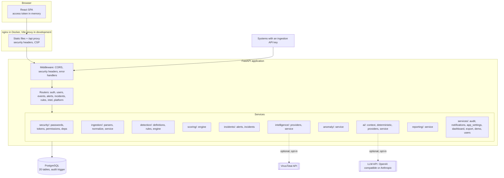
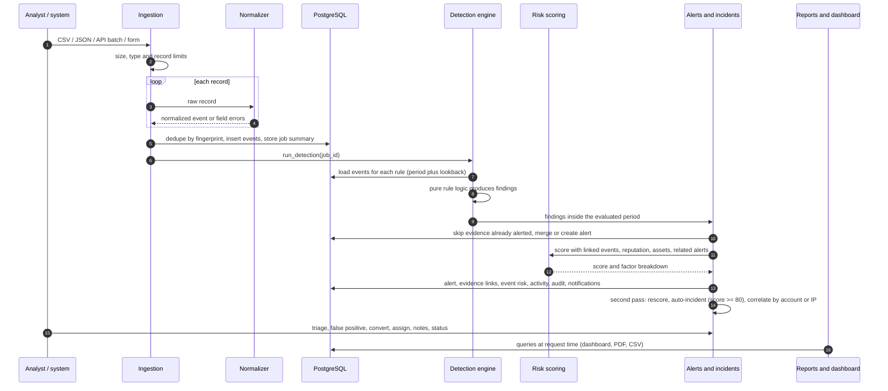

# Architecture

This document is the technical architecture proposal for Sentinel, updated to match what was built. It covers the components and their interfaces, how data flows from ingestion to reporting, the repository layout, the main design decisions, the development roadmap, dependencies, and the assumptions and risks identified at the start.

## 1. Architecture proposal

Sentinel is a **modular monolith**: one FastAPI process that contains separate modules with clear interfaces, one PostgreSQL database and one React single-page application. For a platform that must run on an ordinary laptop, offline, and be understandable by one person, this is a better fit than microservices: there is no message broker, service discovery or distributed transaction to operate, yet each module can be read, tested and replaced on its own.

Three principles shape every module:

1. **The deterministic detection engine is the foundation.** Rules decide what is suspicious. Machine learning and AI only add context, and both are optional.
2. **The database is the single source of truth.** Every dashboard number, chart and report is a query over stored records at request time. Nothing is computed in the browser and nothing is hardcoded.
3. **Optional services fail closed and quietly.** Without network access, API keys or AI configuration the platform keeps working and says which service is unavailable.

## 2. System diagram



## 3. Components and interfaces

| # | Component | Location | Responsibility | Interface |
|---|-----------|----------|----------------|-----------|
| 1 | Frontend | `frontend/src` | Screens, navigation by permission, forms, charts | REST over `/api/v1` with `services/api.ts` |
| 2 | Backend API | `backend/app/api` | Routing, validation (Pydantic), serialization, permission dependencies | HTTP/JSON, OpenAPI at `/api/v1/docs` |
| 3 | Authentication and authorization | `app/security`, `services/users.py` | Argon2id hashing, JWT access tokens, rotating refresh tokens, lockout, RBAC | `get_current_user`, `require(Perm.X)` dependencies |
| 4 | Log ingestion | `app/ingestion/service.py`, `parsers.py` | Parse uploads and API batches, enforce limits, store, record jobs | `ingest_records(db, records, ...) -> IngestionJob` |
| 5 | Normalization | `app/ingestion/normalize.py` | Map aliases, validate, UTC timestamps, sanitize, fingerprint | `normalize_record(dict) -> (NormalizedEvent, errors)` |
| 6 | Detection engine | `app/detection` | Load events per rule, run rule logic, keep in-period findings | `run_detection(db, job_id|start/end) -> summary`; rules are pure `evaluate(events, params, ctx)` |
| 7 | Risk scoring | `app/scoring/engine.py` | Documented formula with per-factor breakdown | `calculate(ScoreInput, reputation, assets) -> ScoreResult` |
| 8 | Threat intelligence | `app/intelligence` | Local indicators, optional VirusTotal, cache, reputation map | `lookup(db, ip, actor)`, `reputation_map(db)` |
| 9 | Anomaly detection | `app/anomaly/service.py` | Feature building, Isolation Forest, explanations, review | `run(db, actor)`, `review(...)` |
| 10 | Incident management | `app/incidents` | Alert creation, merging, triage, incidents, correlation | `process_finding`, `convert_alert`, `change_status`, ... |
| 11 | AI security analyst | `app/ai` | Minimized context, deterministic explanations, optional LLM | `explain_alert`, `summarize_incident`, `ask` |
| 12 | Notifications | `services/notifications.py` | In-app messages per user and role | `notify_user`, `notify_roles` |
| 13 | Reporting | `app/reporting/service.py`, `services/export.py` | PDF reports with hashes, CSV/JSON exports | `generate(db, type, actor, ...)` |
| 14 | Database | `app/models`, `alembic/` | Schema, constraints, migrations | SQLAlchemy ORM |
| 15 | Audit logging | `services/audit.py` | Append-only records with secret redaction | `audit.record(db, action, actor=..., ...)` |

## 4. Data flow



## 5. Repository structure

```
sentinel-security-platform/
├── backend/
│   ├── app/
│   │   ├── api/            routes/ (8 routers), serializers, pagination helpers
│   │   ├── core/           config, error handling, rate limiter
│   │   ├── database/       declarative base, engine and sessions
│   │   ├── models/         SQLAlchemy models (20 tables)
│   │   ├── schemas/        Pydantic request and response models
│   │   ├── security/       password hashing, tokens, permissions, FastAPI dependencies
│   │   ├── ingestion/      parsers, normalization, ingestion service
│   │   ├── detection/      rule definitions, rule logic, engine
│   │   ├── scoring/        risk scoring formula
│   │   ├── intelligence/   VirusTotal provider, local dataset, cache
│   │   ├── anomaly/        Isolation Forest service
│   │   ├── incidents/      alert and incident services
│   │   ├── ai/             context builder, deterministic explainer, providers, glossary
│   │   ├── reporting/      PDF reports
│   │   ├── services/       audit, notifications, settings, dashboard, export, demo, users
│   │   ├── cli.py          seed, create-admin, load-demo
│   │   └── main.py         application factory
│   ├── alembic/            migrations (0001 initial schema + audit trigger)
│   ├── tests/              180 pytest tests
│   ├── Dockerfile, docker-entrypoint.sh, requirements*.txt
├── frontend/
│   ├── src/                components/, contexts/, hooks/, layouts/, pages/ (17), services/, types/, utils/
│   ├── tests/              Vitest + Testing Library
│   ├── Dockerfile, nginx.conf, package.json
├── e2e/                    offline acceptance test (Playwright)
├── sample_data/            logs/ (CSV, JSON), datasets/ (local threat intel)
├── scripts/                dataset generator, screenshot capture
├── docs/                   this documentation and screenshots
├── .github/workflows/      CI
├── docker-compose.yml, .env.example, README.md, SECURITY.md, CONTRIBUTING.md, LICENSE, CHANGELOG.md
```

The specification suggested a top-level `database/` folder for migrations and seeds. Migrations live in `backend/alembic` because Alembic must import the backend's models, and seed data lives in `sample_data/` plus `app/detection/definitions.py`; an empty top-level folder would only duplicate them.

## 6. Key design decisions

| Decision | Alternatives considered | Reason |
|----------|------------------------|--------|
| Rules are pure functions over `EventView` objects | Rules querying the database directly | Rules can be tested with hand-built events, no database needed; the engine owns all I/O. |
| Greedy, deterministic windowing for threshold rules | Sliding windows that emit overlapping alerts | The same input always yields the same bursts, so repeated processing cannot create different alerts. |
| Duplicate control by evidence (an event backs at most one alert per rule) plus merging by rule and group key | Unique keys per time bucket | Bucket boundaries split bursts; evidence-based control is exact and explainable. |
| New evidence reopens a closed alert | Ignore events matching a false positive | The specification forbids suppressing future events based on one analyst decision. |
| Incident risk is the maximum alert score | Sum of alert scores | Several alerts about the same activity must not inflate risk. |
| Access token in memory, refresh token in an HttpOnly SameSite=Strict cookie | Token in localStorage | Script injection cannot read a stored token; CSRF cannot use the cookie cross-site; the cookie is only sent to `/auth`. |
| Synchronous detection after ingestion | Celery or RQ worker | Avoids Redis and worker processes; the demo dataset (about 7,000 events) is processed in about 5 seconds. Documented as a limitation. |
| Audit immutability enforced by a PostgreSQL trigger | Application convention only | Even code with database access cannot alter history. |
| Anomaly results are advisory and never create alerts | Feed anomalies into scoring | The specification requires that ML is never the sole basis for a security decision. |
| AI receives a minimized JSON summary and returns text only | Sending raw logs, giving the model tools | Limits data exposure and removes any path from model output to an action. |

## 7. Development roadmap (as executed)

| Phase | Work | Gate evidence |
|-------|------|---------------|
| A. Planning | Requirements analysis, architecture, data model, API contracts, security model | This document and the other files in `docs/` |
| B. Backend foundation | Config, models, migration, auth, RBAC, error handling | `test_auth.py`, `test_authorization.py`; migration tested up, down and up on an empty database |
| C. Ingestion | Parsers, normalization, dedupe, jobs, sample data | `test_ingestion.py`; demo dataset loads with expected counts |
| D. Detection and risk | Ten rules, engine, scoring, intelligence, anomaly | `test_detection_rules.py`, `test_detection_engine.py`, `test_scoring.py`, `test_intel_ai_anomaly.py` |
| E. Incident management | Alerts, incidents, notes, assignments, audit | `test_incidents.py`, `test_reports_audit_dashboard.py` |
| F. Frontend | Design system and all screens | Typecheck, Vitest suite, browser screenshots of every page |
| G. AI integration | Provider abstraction, deterministic fallback, failure tests | AI tests with mocked providers, prompt-injection fixture in the dataset |
| H. Integration | Frontend and backend against PostgreSQL | Offline acceptance test: 18 of 18 steps |
| I. Quality assurance | Full suites, dependency audits, responsive check | See `docs/development-report.md` |
| J. Packaging | Docker, CI, documentation | Compose file, Dockerfiles, entrypoint verified outside Docker |

## 8. Dependencies

Runtime (backend): FastAPI, Uvicorn, SQLAlchemy, Alembic, psycopg 3, Pydantic and pydantic-settings, email-validator, argon2-cffi, PyJWT, python-multipart, httpx, pandas, NumPy, scikit-learn, ReportLab. Runtime (frontend): React, React DOM, React Router, Recharts, lucide-react. Build and test: TypeScript, Vite, Tailwind CSS, Vitest, Testing Library, jsdom, pytest, pytest-cov, pypdf, Playwright. Exact versions are pinned in `backend/requirements.txt` and `frontend/package-lock.json`.

No dependency requires a paid service. VirusTotal and the LLM providers are optional and contacted over plain HTTPS through httpx.

## 9. Assumptions and risks

| Assumption or risk | Impact | Mitigation in this release |
|--------------------|--------|-----------------------------|
| Logs arrive in many formats | Rejected or misread records | Alias mapping, category inference, warnings for every assumption, rejection with reasons instead of silent drops |
| Source timestamps without a timezone | Wrong hour-of-day decisions | Assumed UTC with a stored warning; database sessions pinned to UTC (a real bug found during testing) |
| Rule thresholds produce noise in a new environment | Alert fatigue | All thresholds configurable, false-positive workflow, rule performance table on the dashboard |
| Reputation feeds are stale or wrong | Unfair scores | Reputation adds bounded points and is labelled "context, not proof"; missing data never means safe |
| Prompt injection through log content | AI output manipulated | Untrusted fields marked and sanitized, AI has no actions, deterministic explanation always shown alongside |
| Large uploads | Slow requests | 10 MB and 50,000 record limits, batch inserts; a background queue is listed as future work |
| Single process rate limiting | Weaker limits with many workers | Database-backed account lockout as a second control; documented |
| Docker unavailable in the build environment | Compose not exercised end to end | Runtime steps of the backend image verified in a clean virtualenv; listed in the development report |
