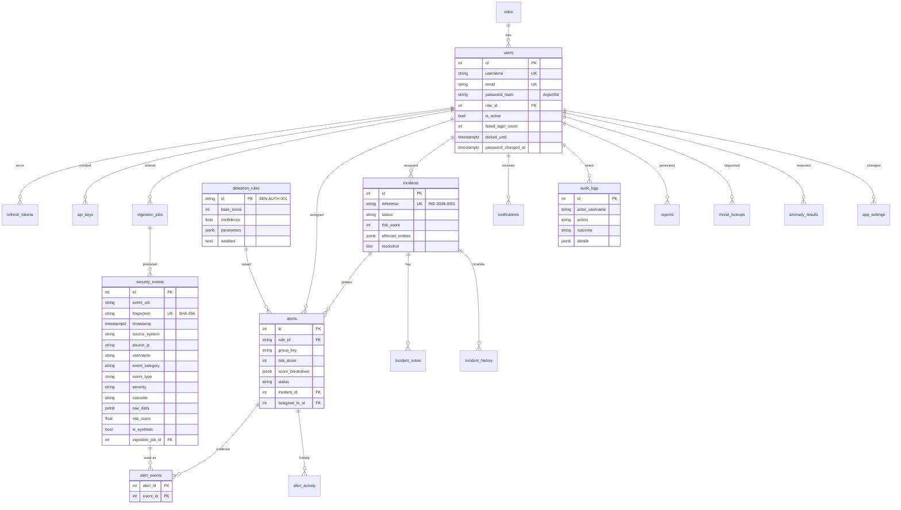

# Database design

PostgreSQL 16 is the authoritative store. The schema is created by the Alembic migration `backend/alembic/versions/0001_initial_schema.py`, which was tested upgrading an empty database, downgrading and upgrading again. SQLite is supported for quick local experiments only.

## Entity relationship diagram



Tables not drawn in detail: `roles`, `refresh_tokens`, `api_keys`, `ingestion_jobs`, `alert_activity`, `incident_notes`, `incident_history`, `threat_indicators`, `threat_lookups`, `anomaly_results`, `notifications`, `app_settings`, `reports`. All are defined in `backend/app/models`.

## Tables

| Table | Purpose | Notable constraints |
|-------|---------|---------------------|
| `roles` | The four roles | `name` unique |
| `users` | Accounts | `username`, `email` unique; `role_id` RESTRICT |
| `refresh_tokens` | SHA-256 of refresh tokens, expiry, revocation | `token_hash` unique; CASCADE with user |
| `api_keys` | Ingestion keys (hash and display prefix only) | `key_hash` unique |
| `ingestion_jobs` | One row per upload or API batch with counts, errors and the detection summary | |
| `security_events` | Normalized events | `fingerprint` unique (duplicate control) |
| `detection_rules` | Rule configuration (parameters in JSONB) | Primary key is the rule ID |
| `alerts` | Alerts with score breakdown and evidence summary | `rule_id` RESTRICT, `incident_id` RESTRICT |
| `alert_events` | Evidence links | `(alert_id, event_id)` unique |
| `alert_activity` | Append-only alert history and notes | |
| `incidents` | Investigations | `reference` unique |
| `incident_notes`, `incident_history` | Notes and timeline | CASCADE with incident (incidents cannot be deleted through the app) |
| `threat_indicators` | Local intelligence dataset | `(indicator, source)` unique |
| `threat_lookups` | Lookup records and cache (`expires_at`) | |
| `anomaly_results` | Flagged account-hours with review status | |
| `notifications` | Per-user in-app messages | |
| `audit_logs` | Append-only trail | UPDATE and DELETE blocked by trigger |
| `app_settings` | Administrator settings as JSON values | Primary key is the setting name |
| `reports` | Report metadata, SHA-256 and the PDF bytes | |

## Data types

- All timestamps are `timestamptz` and stored in UTC. Database sessions set `timezone=UTC` so values read back in UTC whatever the server default is (this fixed a real bug where hour-of-day rules saw local time).
- Flexible payloads (`raw_data`, rule `parameters`, `score_breakdown`, `details`) use `JSONB` on PostgreSQL and `JSON` on SQLite.
- IP addresses are stored as normalized text (`VARCHAR(45)`) after validation with Python's `ipaddress` module, which keeps the schema portable to SQLite.

## Indexes

Chosen for the queries the application actually runs:

| Index | Used by |
|-------|---------|
| `security_events(timestamp)` | Time range filters, dashboard, detection windows |
| `security_events(event_category, timestamp)` | Detection prefilter per rule |
| `security_events(username, timestamp)`, `(source_ip, timestamp)` | Entity searches, related activity |
| `security_events(severity)`, `(risk_score)`, `(is_synthetic)`, `(source_system)`, `(event_type)`, `(ingestion_job_id)` | Explorer filters, demo reset |
| `alerts(status)`, `(severity)`, `(risk_score)`, `(last_seen)`, `(rule_id)`, `(group_key)`, `(incident_id)`, `(assigned_to_id)` | Alert lists, merging, dashboard |
| `incidents(status)`, `(severity)`, `(detected_at)` | Incident lists, dashboard |
| `alert_events(alert_id)`, `(event_id)` | Evidence lookups both directions |
| `audit_logs(action)`, `(created_at)`, `(actor_id)` | Audit filters |
| `notifications(user_id)`, `(is_read)`, `(created_at)` | Unread counts |
| `threat_lookups(indicator, provider)` | Cache lookups |

## Deletion policies

| Relationship | Policy | Reason |
|--------------|--------|--------|
| `alerts.incident_id -> incidents` | RESTRICT | An incident that has alerts cannot be deleted (tested). |
| `alerts.rule_id -> detection_rules` | RESTRICT | Rules with alerts cannot disappear; they are disabled instead. |
| `users.role_id -> roles` | RESTRICT | |
| References to `users` from alerts, incidents, audit, reports | SET NULL | Removing a user never removes security history. The application deactivates users rather than deleting them. |
| `alert_events`, `alert_activity` -> `alerts` | CASCADE | Evidence links and history only exist with their alert (used by demo reset). |
| `audit_logs` | No delete at all | Trigger `audit_logs_no_update_delete` raises on UPDATE or DELETE. `TRUNCATE` is still possible for a database owner, which is why database credentials must be protected. |

## Consistency and transactions

Each request uses one SQLAlchemy session. Changes and their audit records are committed in the same transaction, so an action is never recorded without its audit entry or vice versa. Ingestion commits the job and events first, then runs detection and commits per rule, so a failure in one rule cannot lose stored events.

## Backup and recovery

```bash
# Full logical backup (custom format, compressed)
pg_dump -Fc -h localhost -U sentinel sentinel > sentinel-$(date +%F).dump

# With Docker Compose
docker compose exec db pg_dump -Fc -U sentinel sentinel > sentinel-$(date +%F).dump

# Restore into an empty database, then bring the schema to the current version
pg_restore -h localhost -U sentinel -d sentinel --clean --if-exists sentinel-YYYY-MM-DD.dump
cd backend && alembic upgrade head
```

Recommended practice: daily dumps kept for 30 days, stored away from the database host, and a restore test after every schema change. The named Docker volume `sentinel_pgdata` survives `docker compose down` but is removed by `docker compose down -v`.
