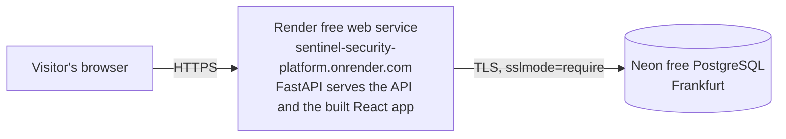

# Deployment guide

Sentinel can be deployed three ways:

| Option | Use for | Files |
|--------|---------|-------|
| **Render + Neon (free)** | The public demo site | `Dockerfile`, `render.yaml` |
| Docker Compose | Running everything on one machine | `docker-compose.yml`, `backend/Dockerfile`, `frontend/Dockerfile` |
| Services without Docker | Development | see the README |

## Public deployment: Render web service + Neon PostgreSQL

### Architecture



- **One service, one origin.** The root `Dockerfile` builds the React app and copies it into the Python image; FastAPI serves `/api/v1/*` and the web pages. Same-origin hosting keeps the `SameSite=Strict` refresh cookie working and avoids CORS entirely.
- **HTTPS** is provided by Render on the `.onrender.com` subdomain. With `SENTINEL_ENVIRONMENT=production` the app sends HSTS, marks cookies `Secure` and turns off the interactive API docs.
- **Database**: Neon's free plan has no expiry date (Render's free PostgreSQL is deleted after 30 days). The connection string is set as a secret in Render, never in Git.
- **Demo data**: with `SENTINEL_LOAD_DEMO_ON_EMPTY=true` the synthetic dataset loads automatically into an empty database.
- **Public demo**: with `SENTINEL_PUBLIC_DEMO=true` the landing page offers "Explore the live demo", which signs visitors in to a shared Read-Only Viewer account that has no usable password.

### Free-tier limits to know

| Limit | Effect |
|-------|--------|
| Render free web services sleep after 15 minutes without traffic | The first visit after a quiet period takes about a minute; the landing page says so. |
| 512 MB RAM, shared CPU | Fine for the demo; large uploads are slower than locally. |
| Ephemeral filesystem | Nothing is stored on disk; everything lives in PostgreSQL. |
| 750 free instance hours per month | Enough for one service running all month. |
| Neon free plan: 1 GB storage, 100 compute-hours per month, compute pauses after 5 idle minutes | The demo uses a few MB. Render's health check uses `/api/v1/health`, which does not touch the database, so Neon can pause between visits and the compute hours last the month. The first query after a pause takes a few hundred milliseconds. |

### Steps

1. **Neon**: create a project (PostgreSQL 16 or 17, region AWS Europe Frankfurt) and copy the connection string. Keep it out of chat, email and Git.
2. **Render**: New > Blueprint, connect the GitHub repository `leonce12/sentinel-security-platform`. Render reads `render.yaml`.
3. Render asks for the values marked `sync: false`:
   - `SENTINEL_DATABASE_URL`: the Neon connection string (the `postgresql://` form works as is).
   - `SENTINEL_BOOTSTRAP_ADMIN_USERNAME`, `_EMAIL`, `_PASSWORD`: your administrator account. The password must be 12+ characters with three of lowercase, uppercase, digit, symbol, and must not contain the username.
4. Apply. Render builds the image (about 5 to 8 minutes), runs `alembic upgrade head`, starts the API, creates the administrator and loads the demo data.
5. Check `https://<service>.onrender.com/api/v1/health/ready` (this one does query the database) returns `{"status":"ok","database":"postgresql",...}`.
6. Sign in as the administrator, then **delete `SENTINEL_BOOTSTRAP_ADMIN_PASSWORD`** from the Render environment. The account stays; the variable is only read when no administrator exists.

`SENTINEL_SECRET_KEY` is generated by Render (`generateValue: true`). Rotating it signs everyone out.

### After 30 days, or if the database is lost

Nothing to do on Neon's free plan. If you ever switch to a new empty database, update `SENTINEL_DATABASE_URL`; migrations, the administrator (if the bootstrap variables are set again) and the demo data are recreated on the next start.

### Verifying a deployment

```bash
python e2e/smoke_public.py --base-url https://sentinel-security-platform.onrender.com --report docs/live-smoke-results.md
```

The script checks the landing page, health and database, security headers, the read-only demo, every viewer page, that administrative pages are refused, the mobile layout and console errors.

## Docker Compose

```bash
cp .env.example .env            # set POSTGRES_PASSWORD and SENTINEL_SECRET_KEY
docker compose up --build -d
docker compose exec backend python -m app.cli create-admin --username admin --email admin@example.com
```

Open http://localhost:8080. nginx serves the web app and proxies `/api` to the backend.

## Environment variables

See `.env.example` for the full list. Deployment-specific variables:

| Variable | Default | Purpose |
|----------|---------|---------|
| `SENTINEL_ENVIRONMENT` | development | `production` enables HSTS, hides API docs and warns if cookies are not Secure |
| `SENTINEL_FRONTEND_DIR` | unset | Folder with the built React app to serve from the API (set in the root Dockerfile) |
| `SENTINEL_PUBLIC_DEMO` | false | Enables the read-only demo sign-in |
| `SENTINEL_DEMO_USERNAME` | demo.viewer | Name of the shared demo account |
| `SENTINEL_LOAD_DEMO_ON_EMPTY` | false | Loads the synthetic dataset into an empty database |
| `SENTINEL_BOOTSTRAP_ADMIN_USERNAME`, `_EMAIL`, `_PASSWORD` | unset | First administrator, created only if none exists |
| `SENTINEL_EXPOSE_API_DOCS` | off in production | Serves `/api/v1/docs` |
| `SENTINEL_MAX_REQUEST_MB` | 12 | Hard cap on any request body |
| `PORT` | 8000 | Listening port (set by Render) |
